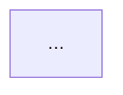

# 플로우차트(Mermaid) 작성 규칙

> **Owner** 황다혜 프로 · **Resource** https://github.com/starryetribe-droid/AX-Pilot/tree/main
> 원본 가이드의 플로우차트 규칙을 이 리포에서 오프라인으로 쓸 수 있게 정리한 것이다.
> 서버 토큰이 있으면 `fetch_guide.py`가 서버 최신본을 우선 사용한다.

`SKILL.md` §3 PRD 모드 **Step 2.5(Mermaid 프리뷰)** 에서 이 규칙으로 작성한 뒤 사용자 승인을 받는다.
승인된 Mermaid는 PRD §3 본문에 **그대로** 들어간다 — 본문 작성 때 다시 그리지 않는다.

방향은 `flowchart TD`(위→아래)를 기본으로 한다.

---

## 1. 도형 6가지

| 도형 | Mermaid | 용도 | 예시 |
|---|---|---|---|
| 시작/종료 | `([텍스트])` | 플로우의 시작과 끝 | "로그인 페이지 진입", "완료" |
| 처리/작업 | `[텍스트]` | 일반 처리 단계 | "ID/PW 입력", "토큰 발급" |
| 조건 분기 | `{텍스트}` | Yes/No 판단 | "입력값 유효?", "인증 성공?" |
| 서브 프로세스 | `[[텍스트]]` | 별도로 분리되는 하위 프로세스 | "본인인증 프로세스" |
| 데이터 입출력 | `[/텍스트/]` | 사용자 입력 또는 API 응답 | "사용자 정보 입력", "API 응답" |
| 외부 시스템 | `((텍스트))` | 외부 API·시스템 호출 | "PG사 결제 요청", "카카오 OAuth" |

## 2. 화살표

| 화살표 | Mermaid | 용도 |
|---|---|---|
| 실선 | `-->` | 일반 흐름 |
| 점선 | `-.->` | 비동기·선택적 흐름 |
| 라벨 | `-->|Yes|` · `-->|No|` | 조건 분기 결과 (**필수 표기**) |

## 3. 색상

| 색상 | 용도 | Mermaid style |
|---|---|---|
| 회색 | 시작·종료 | `style N fill:#F1EFE8,stroke:#5F5E5A` |
| 파랑 | 주요 처리 단계 | `style N fill:#E6F1FB,stroke:#185FA5` |
| 노랑 | 조건 분기 | `style N fill:#FAEEDA,stroke:#854F0B` |
| 빨강 | 에러·실패·예외 | `style N fill:#FCEBEB,stroke:#A32D2D` |
| 초록 | 성공·완료 | `style N fill:#EAF3DE,stroke:#3B6D11` |
| 보라 | 외부 시스템·API | `style N fill:#EEEDFE,stroke:#534AB7` |

## 4. 작성 원칙 7가지

1. **흐름 방향 통일** — 위→아래 또는 왼쪽→오른쪽. 한 플로우 안에서 방향을 섞지 않는다.
2. **1도형 1동작** — 한 도형에 동작 하나만. (O: "입력" → "검증" / X: "입력 후 검증")
3. **분기 라벨 필수** — 마름모에서 나가는 모든 화살표에 Yes/No 또는 조건값을 표기한다.
4. **열린 끝 금지** — 모든 경로는 반드시 종료 도형으로 끝난다. 화살표만 남는 상태는 안 된다.
5. **교차 금지** — 화살표가 다른 도형을 가로지르지 않게 우회시킨다.
6. **서브 프로세스 분리** — 서브 프로세스로 표시한 단위는 별도 플로우차트로 분리한다.
7. **외부 연동 구분** — PG사·OAuth·외부 API 호출은 외부 시스템 도형으로 명확히 구분한다.

## 5. 프리뷰 형식

작성한 Mermaid를 아래 형식으로 보여주고 승인을 받는다. 승인 전에는 PRD 본문 작성으로 넘어가지 않는다.

```
[{기능ID} 플로우 초안]



OK신가요? 수정사항 있으면 말씀해주세요.
```

수정 요청이 오면 **Mermaid만 고쳐서 다시 보여준다**(반복). 본문을 먼저 쓰지 않는다.
