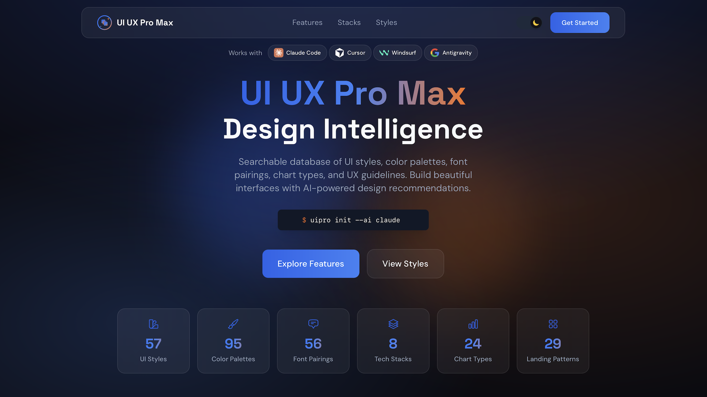

# [UI UX Pro Max](https://uupm.cc)

## 릴리즈노트

| 요약내용 | 업데이트 일자 | 소유자 |
|---|---|---|
| 백업 등록 — v2.11.0, README 한국어 번역 (외부 스킬 백업) | 2026-07-16 | 김단영 |


<p align="center">
  🇰🇷 한국어 |
  <a href="README.en.md">🇺🇸 English</a> |
  <a href="README.zh.md">🇨🇳 简体中文</a>
</p>

> **참고:** 이 폴더는 [nextlevelbuilder/ui-ux-pro-max-skill](https://github.com/nextlevelbuilder/ui-ux-pro-max-skill) 원본 리포(v2.11.0, MIT 라이선스)의 백업본입니다. 이 README는 원본 영문 README(README.en.md)의 한국어 번역본입니다. (2026-07-16 기준)

<p align="center">
  <a href="https://github.com/nextlevelbuilder/ui-ux-pro-max-skill/releases"></a>
  
  
  
  <a href="LICENSE"></a>
</p>

<p align="center">
  <a href="https://www.npmjs.com/package/ui-ux-pro-max-cli"></a>
  <a href="https://www.npmjs.com/package/ui-ux-pro-max-cli"></a>
  <a href="https://github.com/nextlevelbuilder/ui-ux-pro-max-skill/stargazers"></a>
  <a href="https://paypal.me/uiuxpromax"></a>
</p>

여러 플랫폼과 프레임워크에서 전문적인 UI/UX를 구축할 수 있도록 디자인 인텔리전스를 제공하는 AI 스킬입니다.

<p align="center">
  <a href="https://uupm.cc">
    
  </a>
</p>

<p align="center">
  <b>유용하다고 느끼셨다면 프로젝트 후원을 고려해 주세요:</b><br><br>
  <a href="https://paypal.me/uiuxpromax"></a>
</p>

<p align="center">
  <i>다른 프로젝트</i><br>
  <a href="https://nextlevelbuilder.io">NextLevelBuilder.io</a> | <a href="https://goclaw.sh">GoClaw.sh</a> | <a href="https://claudekit.cc">ClaudeKit.cc</a> | <a href="https://tose.sh">TOSE.sh</a>
</p>

## v2.0의 새로운 기능

### 지능형 디자인 시스템 생성

v2.0의 핵심 기능은 **디자인 시스템 생성기(Design System Generator)** 입니다. 프로젝트 요구사항을 분석해 몇 초 만에 완전한 맞춤형 디자인 시스템을 생성하는 AI 추론 엔진입니다.

```
+----------------------------------------------------------------------------------------+
|  TARGET: Serenity Spa - RECOMMENDED DESIGN SYSTEM                                      |
+----------------------------------------------------------------------------------------+
|                                                                                        |
|  PATTERN: Hero-Centric + Social Proof                                                  |
|     Conversion: Emotion-driven with trust elements                                     |
|     CTA: Above fold, repeated after testimonials                                       |
|     Sections:                                                                          |
|       1. Hero                                                                          |
|       2. Services                                                                      |
|       3. Testimonials                                                                  |
|       4. Booking                                                                       |
|       5. Contact                                                                       |
|                                                                                        |
|  STYLE: Soft UI Evolution                                                              |
|     Keywords: Soft shadows, subtle depth, calming, premium feel, organic shapes        |
|     Best For: Wellness, beauty, lifestyle brands, premium services                     |
|     Performance: Excellent | Accessibility: WCAG AA                                    |
|                                                                                        |
|  COLORS:                                                                               |
|     Primary:    #E8B4B8 (Soft Pink)                                                    |
|     Secondary:  #A8D5BA (Sage Green)                                                   |
|     CTA:        #D4AF37 (Gold)                                                         |
|     Background: #FFF5F5 (Warm White)                                                   |
|     Text:       #2D3436 (Charcoal)                                                    |
|     Notes: Calming palette with gold accents for luxury feel                           |
|                                                                                        |
|  TYPOGRAPHY: Cormorant Garamond / Montserrat                                           |
|     Mood: Elegant, calming, sophisticated                                              |
|     Best For: Luxury brands, wellness, beauty, editorial                               |
|     Google Fonts: https://fonts.google.com/share?selection.family=...                  |
|                                                                                        |
|  KEY EFFECTS:                                                                          |
|     Soft shadows + Smooth transitions (200-300ms) + Gentle hover states                |
|                                                                                        |
|  AVOID (Anti-patterns):                                                                |
|     Bright neon colors + Harsh animations + Dark mode + AI purple/pink gradients       |
|                                                                                        |
|  PRE-DELIVERY CHECKLIST:                                                               |
|     [ ] No emojis as icons (use SVG: Heroicons/Lucide)                                 |
|     [ ] cursor-pointer on all clickable elements                                       |
|     [ ] Hover states with smooth transitions (150-300ms)                               |
|     [ ] Light mode: text contrast 4.5:1 minimum                                        |
|     [ ] Focus states visible for keyboard nav                                          |
|     [ ] prefers-reduced-motion respected                                               |
|     [ ] Responsive: 375px, 768px, 1024px, 1440px                                       |
|                                                                                        |
+----------------------------------------------------------------------------------------+
```

### 디자인 시스템 생성 동작 원리

```
┌─────────────────────────────────────────────────────────────────┐
│  1. 사용자 요청                                                  │
│     "뷰티 스파 랜딩 페이지 만들어줘"                              │
└─────────────────────────────────────────────────────────────────┘
                              │
                              ▼
┌─────────────────────────────────────────────────────────────────┐
│  2. 다중 도메인 검색 (5개 병렬 검색)                              │
│     • 제품 유형 매칭 (192개 카테고리)                             │
│     • 스타일 추천 (84개 스타일)                                   │
│     • 컬러 팔레트 선택 (192개 팔레트)                             │
│     • 랜딩 페이지 패턴 (34개 패턴)                                │
│     • 타이포그래피 페어링 (74개 폰트 조합)                        │
└─────────────────────────────────────────────────────────────────┘
                              │
                              ▼
┌─────────────────────────────────────────────────────────────────┐
│  3. 추론 엔진                                                    │
│     • 제품 → UI 카테고리 규칙 매칭                                │
│     • 스타일 우선순위 적용 (BM25 랭킹)                            │
│     • 업종별 안티패턴 필터링                                      │
│     • 의사결정 규칙 처리 (JSON 조건)                              │
└─────────────────────────────────────────────────────────────────┘
                              │
                              ▼
┌─────────────────────────────────────────────────────────────────┐
│  4. 완성된 디자인 시스템 출력                                     │
│     패턴 + 스타일 + 컬러 + 타이포그래피 + 효과                    │
│     + 피해야 할 안티패턴 + 납품 전 체크리스트                     │
└─────────────────────────────────────────────────────────────────┘
```

### 161개 업종별 추론 규칙

추론 엔진에는 다음 분야에 특화된 규칙이 포함되어 있습니다:

| 카테고리 | 예시 |
|----------|------|
| **테크 & SaaS** | SaaS, 마이크로 SaaS, B2B 서비스, 개발자 도구/IDE, AI·챗봇 플랫폼, 사이버보안 플랫폼 |
| **금융** | 핀테크/크립토, 뱅킹, 보험, 개인 자산관리 트래커, 인보이스·빌링 도구 |
| **헬스케어** | 병·의원, 약국, 치과, 동물병원, 멘탈 헬스, 복약 알림 |
| **이커머스** | 일반, 럭셔리, 마켓플레이스(P2P), 구독 박스, 음식 배달 |
| **서비스** | 뷰티/스파, 레스토랑, 호텔, 법률, 홈서비스, 예약·스케줄링 |
| **크리에이티브** | 포트폴리오, 에이전시, 사진, 게임, 음악 스트리밍, 사진/영상 편집기 |
| **라이프스타일** | 습관 트래커, 레시피·요리, 명상, 날씨, 다이어리, 무드 트래커 |
| **신기술** | Web3/NFT, 공간 컴퓨팅, 양자 컴퓨팅, 자율 드론 플릿 |

각 규칙에는 다음이 포함됩니다:
- **추천 패턴** - 랜딩 페이지 구조
- **스타일 우선순위** - 가장 잘 맞는 UI 스타일
- **컬러 무드** - 업종에 맞는 팔레트
- **타이포그래피 무드** - 폰트 성격 매칭
- **핵심 효과** - 애니메이션과 인터랙션
- **안티패턴** - 하지 말아야 할 것 (예: 뱅킹에서 "AI 보라/핑크 그라데이션" 금지)

## 주요 기능

- **84개 UI 스타일** - 글래스모피즘, 클레이모피즘, 미니멀리즘, 브루탈리즘, 뉴모피즘, 벤토 그리드, 다크 모드, AI 네이티브 UI 등
- **192개 컬러 팔레트** - 192개 제품 유형과 1:1로 매칭된 업종별 팔레트
- **74개 폰트 페어링** - Google Fonts 임포트 코드가 포함된 엄선된 타이포그래피 조합
- **25개 차트 유형** - 대시보드·애널리틱스용 추천
- **22개 기술 스택** - React, Next.js, Astro, Vue, Nuxt.js, Nuxt UI, Svelte, SwiftUI, React Native, Flutter, HTML+Tailwind, shadcn/ui, Jetpack Compose, Angular, Laravel, Three.js, JavaFX, WPF, WinUI 3, UWP, Avalonia, Uno Platform
- **98개 UX 가이드라인** - 모범 사례, 안티패턴, 접근성 규칙
- **161개 추론 규칙** - 업종별 디자인 시스템 생성 (v2.0 신규)

### 제공 스타일 (67)

<details>
<summary><b>일반 스타일 (49)</b></summary>

| # | 스타일 | 적합한 용도 |
|---|-------|------------|
| 1 | 미니멀리즘 & 스위스 스타일 | 엔터프라이즈 앱, 대시보드, 문서 |
| 2 | 뉴모피즘 | 헬스/웰니스 앱, 명상 플랫폼 |
| 3 | 글래스모피즘 | 모던 SaaS, 금융 대시보드 |
| 4 | 브루탈리즘 | 디자인 포트폴리오, 아트 프로젝트 |
| 5 | 3D & 하이퍼리얼리즘 | 게임, 제품 쇼케이스, 몰입형 |
| 6 | 비비드 & 블록 기반 | 스타트업, 크리에이티브 에이전시, 게임 |
| 7 | 다크 모드 (OLED) | 야간 모드 앱, 코딩 플랫폼 |
| 8 | 접근성 & 윤리적 디자인 | 정부, 헬스케어, 교육 |
| 9 | 클레이모피즘 | 교육 앱, 어린이 앱, SaaS |
| 10 | 오로라 UI | 모던 SaaS, 크리에이티브 에이전시 |
| 11 | 레트로 퓨처리즘 | 게임, 엔터테인먼트, 음악 플랫폼 |
| 12 | 플랫 디자인 | 웹 앱, 모바일 앱, 스타트업 MVP |
| 13 | 스큐어모피즘 | 레거시 앱, 게임, 프리미엄 제품 |
| 14 | 리퀴드 글래스 | 프리미엄 SaaS, 하이엔드 이커머스 |
| 15 | 모션 드리븐 | 포트폴리오 사이트, 스토리텔링 플랫폼 |
| 16 | 마이크로 인터랙션 | 모바일 앱, 터치스크린 UI |
| 17 | 인클루시브 디자인 | 공공 서비스, 교육, 헬스케어 |
| 18 | 제로 인터페이스 | 음성 어시스턴트, AI 플랫폼 |
| 19 | 소프트 UI 에볼루션 | 모던 엔터프라이즈 앱, SaaS |
| 20 | 뉴브루탈리즘 | Gen Z 브랜드, 스타트업, Figma 스타일 |
| 21 | 벤토 박스 그리드 | 대시보드, 제품 페이지, 포트폴리오 |
| 22 | Y2K 미학 | 패션 브랜드, 음악, Gen Z |
| 23 | 사이버펑크 UI | 게임, 테크 제품, 크립토 앱 |
| 24 | 오가닉 바이오필릭 | 웰니스 앱, 지속가능성 브랜드 |
| 25 | AI 네이티브 UI | AI 제품, 챗봇, 코파일럿 |
| 26 | 멤피스 디자인 | 크리에이티브 에이전시, 음악, 영 브랜드 |
| 27 | 베이퍼웨이브 | 음악 플랫폼, 게임, 포트폴리오 |
| 28 | 디멘셔널 레이어링 | 대시보드, 카드 레이아웃, 모달 |
| 29 | 과장된 미니멀리즘 | 패션, 건축, 포트폴리오 |
| 30 | 키네틱 타이포그래피 | 히어로 섹션, 마케팅 사이트 |
| 31 | 패럴랙스 스토리텔링 | 브랜드 스토리텔링, 제품 런칭 |
| 32 | 스위스 모더니즘 2.0 | 기업 사이트, 건축, 에디토리얼 |
| 33 | HUD / Sci-Fi FUI | SF 게임, 우주 기술, 사이버보안 |
| 34 | 픽셀 아트 | 인디 게임, 레트로 도구, 크리에이티브 |
| 35 | 벤토 그리드 | 제품 기능 소개, 대시보드, 개인 사이트 |
| 36 | 공간 UI (VisionOS) | 공간 컴퓨팅 앱, VR/AR |
| 37 | E-Ink / 페이퍼 | 독서 앱, 디지털 신문 |
| 38 | Gen Z 카오스 / 맥시멀리즘 | Gen Z 라이프스타일, 뮤지션 |
| 39 | 바이오미메틱 / 오가닉 2.0 | 지속가능성 테크, 바이오테크, 헬스 |
| 40 | 안티폴리시 / 로우 미학 | 크리에이티브 포트폴리오, 아티스트 사이트 |
| 41 | 택타일 디지털 / 변형 UI | 모던 모바일 앱, 유쾌한 브랜드 |
| 42 | 네이처 디스틸드 | 웰니스 브랜드, 지속가능 제품 |
| 43 | 인터랙티브 커서 디자인 | 크리에이티브 포트폴리오, 인터랙티브 |
| 44 | 보이스 퍼스트 멀티모달 | 음성 어시스턴트, 접근성 앱 |
| 45 | 3D 제품 프리뷰 | 이커머스, 가구, 패션 |
| 46 | 그라데이션 메시 / 오로라 에볼브드 | 히어로 섹션, 배경, 크리에이티브 |
| 47 | 에디토리얼 그리드 / 매거진 | 뉴스 사이트, 블로그, 매거진 |
| 48 | 색수차 / RGB 스플릿 | 음악 플랫폼, 게임, 테크 |
| 49 | 빈티지 아날로그 / 레트로 필름 | 사진, 음악/바이닐 브랜드 |

</details>

<details>
<summary><b>랜딩 페이지 스타일 (8)</b></summary>

| # | 스타일 | 적합한 용도 |
|---|-------|------------|
| 1 | 히어로 중심 디자인 | 시각적 아이덴티티가 강한 제품 |
| 2 | 전환 최적화 | 리드 생성, 세일즈 페이지 |
| 3 | 기능 중심 쇼케이스 | SaaS, 복잡한 제품 |
| 4 | 미니멀 & 다이렉트 | 심플한 제품, 앱 |
| 5 | 소셜 프루프 중심 | 서비스, B2C 제품 |
| 6 | 인터랙티브 제품 데모 | 소프트웨어, 도구 |
| 7 | 신뢰 & 권위 | B2B, 엔터프라이즈, 컨설팅 |
| 8 | 스토리텔링 드리븐 | 브랜드, 에이전시, 비영리 |

</details>

<details>
<summary><b>BI/애널리틱스 대시보드 스타일 (10)</b></summary>

| # | 스타일 | 적합한 용도 |
|---|-------|------------|
| 1 | 데이터 밀집형 대시보드 | 복잡한 데이터 분석 |
| 2 | 히트맵 스타일 | 지리/행동 데이터 |
| 3 | 임원용 대시보드 | C레벨 요약 보고 |
| 4 | 실시간 모니터링 | 운영, DevOps |
| 5 | 드릴다운 애널리틱스 | 상세 탐색 |
| 6 | 비교 분석 대시보드 | 나란히 비교 |
| 7 | 예측 애널리틱스 | 예측, ML 인사이트 |
| 8 | 사용자 행동 애널리틱스 | UX 리서치, 프로덕트 애널리틱스 |
| 9 | 금융 대시보드 | 재무, 회계 |
| 10 | 세일즈 인텔리전스 대시보드 | 영업팀, CRM |

</details>

## 💎 기본 버전 vs. 프리미엄 버전 비교

오픈소스 버전과 프리미엄 버전의 차이를 묻는 사용자가 많습니다. 워크플로에 맞는 버전을 고를 수 있도록 정리했습니다.

### 🟢 기본 버전 (이 리포지토리)
* **완전한 오픈소스:** 개인 개발자, 취미 개발자, 일반 프로젝트에 적합합니다.
* **핵심 UI/UX 인텔리전스:** 84개 UI 스타일, 192개 제품 유형, 컬러 팔레트, 엄선된 폰트 페어링 전체 이용 가능.
* **스마트 추천:** 매우 정확한 디자인 매칭을 위한 BM25 검색 엔진 내장.
* **크로스 플랫폼 지원:** 22개 주요 프레임워크(React, Vue, Tailwind, iOS, Android 등)의 스택별 가이드라인.
* **디자인 시스템 생성:** CLI로 맞춤형 UI 규칙·패턴·로직을 즉시 생성.

### 🟡 프리미엄 버전
* **확장된 브랜드 디자인 스킬:** UI/UX를 넘어 브랜드 아이덴티티 생성, 로고 디자인, CIP(기업 아이덴티티 프로그램), 배너, 프레젠테이션 슬라이드, 커스텀 아이콘 제작까지 지원.
* **고급 에셋 제작:** AI 이미지 생성과의 깊은 통합으로 플레이스홀더가 아닌 실제 비주얼 에셋 제작.
* **엔터프라이즈 아키텍처:** 대규모 팀 배포를 위한 더 포괄적이고 확장 가능한 디자인 토큰 아키텍처.
* **우선 지원:** 끊김 없는 풀 디자인 워크플로가 필요한 팀·전문가를 위한 전담 기술 지원.

👉 *프리미엄 업그레이드에 대한 자세한 내용은 [uupm.cc](https://uupm.cc)를 참고하세요.*

## 설치

### Claude 마켓플레이스 사용 (Claude Code)

Claude Code에서 명령어 두 개로 바로 설치할 수 있습니다:

```
/plugin marketplace add nextlevelbuilder/ui-ux-pro-max-skill
/plugin install ui-ux-pro-max@ui-ux-pro-max-skill
```

### CLI 사용 (권장)

```bash
# CLI 전역 설치
npm install -g ui-ux-pro-max-cli

# 프로젝트 폴더로 이동
cd /path/to/your/project

# 사용하는 AI 어시스턴트에 맞춰 설치
uipro init --ai claude      # Claude Code
uipro init --ai cursor      # Cursor
uipro init --ai windsurf    # Windsurf
uipro init --ai antigravity # Antigravity
uipro init --ai copilot     # GitHub Copilot
uipro init --ai kiro        # Kiro
uipro init --ai codex       # Codex CLI
uipro init --ai qoder       # Qoder
uipro init --ai roocode     # Roo Code
uipro init --ai gemini      # Gemini CLI
uipro init --ai trae        # Trae
uipro init --ai opencode    # OpenCode
uipro init --ai continue    # Continue
uipro init --ai codebuddy   # CodeBuddy
uipro init --ai droid       # Droid (Factory)
uipro init --ai kilocode    # KiloCode
uipro init --ai warp        # Warp
uipro init --ai augment     # Augment
uipro init --ai codewhale   # CodeWhale
uipro init --ai all         # 전체 어시스턴트
```

npm 패키지명은 `ui-ux-pro-max-cli`이며, 설치되는 명령어는 여전히 `uipro`입니다. 구버전 `uipro-cli` 릴리스는 오래된 것이므로 최신 에셋에는 사용하지 마세요.

### 전역 설치 (모든 프로젝트에서 사용)

```bash
uipro init --ai claude --global   # ~/.claude/skills/ 에 설치
uipro init --ai cursor --global   # ~/.cursor/skills/ 에 설치
```

### 기타 CLI 명령어

```bash
uipro versions              # 사용 가능한 버전 목록
uipro update                # 설치된 CLI 패키지에서 스킬 파일 갱신
uipro init --offline        # 호환성 플래그; 번들 템플릿 설치
uipro uninstall             # 스킬 제거 (플랫폼 자동 감지)
uipro uninstall --ai claude # 특정 플랫폼에서 제거
uipro uninstall --global    # 전역 설치 제거
```

## 사전 요구사항

검색 스크립트 실행에 Python 3.x가 필요합니다 (표준 라이브러리만 사용 — 스크립트는 아무것도 설치하지 않고 네트워크 호출도 하지 않습니다).

Python 설치 여부 확인:

```bash
python3 --version
```

없다면 [python.org](https://www.python.org/downloads/)나 OS 패키지 매니저(Homebrew, apt, winget)로 직접 설치하세요. 이 설치 단계는 **사람인 사용자**를 위한 것입니다 — 이 스킬을 사용하는 AI 에이전트는 사용자의 컴퓨터에 소프트웨어를 설치해서는 안 되며, 대신 사용자에게 요청하도록 지시되어 있습니다.

## 사용법

### 스킬 모드 (자동 활성화)

**지원:** Claude Code, Cursor, Windsurf, Antigravity, Codex CLI, Continue, Gemini CLI, OpenCode, Qoder, CodeBuddy, Droid (Factory), KiloCode, Warp, Augment, CodeWhale

UI/UX 작업을 요청하면 스킬이 자동으로 활성화됩니다. 그냥 자연스럽게 대화하세요:

```
Build a landing page for my SaaS product
```

> **Trae**: 먼저 **SOLO** 모드로 전환하세요. UI/UX 요청 시 스킬이 활성화됩니다.

### 워크플로 모드 (슬래시 커맨드)

**지원:** Kiro, GitHub Copilot, Roo Code, KiloCode

슬래시 커맨드로 스킬을 호출합니다:

```
/ui-ux-pro-max Build a landing page for my SaaS product
```

### 프롬프트 예시

```
Build a landing page for my SaaS product
(내 SaaS 제품의 랜딩 페이지 만들어줘)

Create a dashboard for healthcare analytics
(헬스케어 애널리틱스 대시보드 만들어줘)

Design a portfolio website with dark mode
(다크 모드 포트폴리오 웹사이트 디자인해줘)

Make a mobile app UI for e-commerce
(이커머스 모바일 앱 UI 만들어줘)

Build a fintech banking app with dark theme
(다크 테마 핀테크 뱅킹 앱 만들어줘)
```

### 동작 방식

1. **요청** - UI/UX 작업(구축, 디자인, 생성, 구현, 리뷰, 수정, 개선)을 요청합니다
2. **디자인 시스템 생성** - AI가 추론 엔진으로 완전한 디자인 시스템을 자동 생성합니다
3. **스마트 추천** - 제품 유형과 요구사항에 맞춰 가장 잘 맞는 스타일·컬러·타이포그래피를 찾습니다
4. **코드 생성** - 적절한 컬러, 폰트, 간격, 모범 사례를 적용해 UI를 구현합니다
5. **납품 전 점검** - 일반적인 UI/UX 안티패턴에 대해 검증합니다

### 지원 스택

스킬은 다음 스택별 가이드라인을 제공합니다:

| 카테고리 | 스택 |
|----------|------|
| **웹 (HTML)** | HTML + Tailwind (기본값) |
| **React 생태계** | React, Next.js, shadcn/ui |
| **Vue 생태계** | Vue, Nuxt.js, Nuxt UI |
| **Angular** | Angular |
| **PHP** | Laravel (Blade, Livewire, Inertia.js) |
| **기타 웹** | Svelte, Astro, Three.js |
| **데스크톱** | JavaFX, WPF, WinUI 3, Avalonia, Uno Platform, UWP |
| **iOS** | SwiftUI |
| **Android** | Jetpack Compose |
| **크로스 플랫폼** | React Native, Flutter |

프롬프트에서 원하는 스택을 언급하거나, 기본값인 HTML + Tailwind를 사용하세요.

## 디자인 시스템 명령어 (고급)

디자인 시스템 생성기에 직접 접근하려면:

> 참고: Continue로 설치했다면 아래 명령어의 `.claude/skills/`를 `.continue/skills/`로 바꾸세요. Droid (Factory)는 `.factory/skills/`를 사용합니다.

```bash
# ASCII 출력으로 디자인 시스템 생성
python3 .claude/skills/ui-ux-pro-max/scripts/search.py "beauty spa wellness" --design-system -p "Serenity Spa"

# Markdown 출력으로 생성
python3 .claude/skills/ui-ux-pro-max/scripts/search.py "fintech banking" --design-system -f markdown

# 도메인별 검색
python3 .claude/skills/ui-ux-pro-max/scripts/search.py "glassmorphism" --domain style
python3 .claude/skills/ui-ux-pro-max/scripts/search.py "elegant serif" --domain typography
python3 .claude/skills/ui-ux-pro-max/scripts/search.py "dashboard" --domain chart

# 스택별 가이드라인
python3 .claude/skills/ui-ux-pro-max/scripts/search.py "form validation" --stack react
python3 .claude/skills/ui-ux-pro-max/scripts/search.py "responsive layout" --stack html-tailwind
python3 .claude/skills/ui-ux-pro-max/scripts/search.py "tableview binding" --stack javafx
python3 .claude/skills/ui-ux-pro-max/scripts/search.py "atlantafx primer enterprise theme" --stack javafx
python3 .claude/skills/ui-ux-pro-max/scripts/search.py "enterprise tableview density permission" --stack javafx
```

### 디자인 시스템 영속화 (Master + Overrides 패턴)

**세션 간 계층적 조회**를 위해 디자인 시스템을 파일로 저장할 수 있습니다:

```bash
# 생성 후 design-system/MASTER.md 로 저장
python3 .claude/skills/ui-ux-pro-max/scripts/search.py "SaaS dashboard" --design-system --persist -p "MyApp"

# 페이지 전용 오버라이드 파일도 함께 생성
python3 .claude/skills/ui-ux-pro-max/scripts/search.py "SaaS dashboard" --design-system --persist -p "MyApp" --page "dashboard"
```

다음과 같은 `design-system/` 폴더 구조가 생성됩니다:

```
design-system/
├── MASTER.md           # 전역 단일 진실 공급원 (컬러, 타이포그래피, 간격, 컴포넌트)
└── pages/
    └── dashboard.md    # 페이지별 오버라이드 (Master와 다른 부분만)
```

**계층적 조회 동작 방식:**
1. 특정 페이지(예: "Checkout")를 만들 때 먼저 `design-system/pages/checkout.md`를 확인합니다
2. 페이지 파일이 존재하면 그 규칙이 Master 파일을 **오버라이드**합니다
3. 없으면 `design-system/MASTER.md`만 사용합니다

**컨텍스트 인지 조회 프롬프트:**
```
I am building the [Page Name] page. Please read design-system/MASTER.md.
Also check if design-system/pages/[page-name].md exists.
If the page file exists, prioritize its rules.
If not, use the Master rules exclusively.
Now, generate the code...
```

## 아키텍처 & 기여

### 사용자용

코드베이스는 **템플릿 기반 생성 시스템**으로 재구성되었습니다. 모든 플랫폼별 파일(`.cursor/`, `.windsurf/`, `.kiro/`, `.factory/` 등)은 이제 CLI가 동적으로 생성합니다.

**설치할 때는 항상 CLI를 사용하세요:**

```bash
npm install -g ui-ux-pro-max-cli
uipro init --ai <platform>
```

이렇게 하면 설치된 CLI 패키지에 번들된 최신 템플릿과 AI 어시스턴트에 맞는 올바른 파일 구조를 받을 수 있습니다. 새 릴리스가 나오면 npm 패키지를 먼저 업데이트하세요.

### 기여자용

이 프로젝트에 기여하려면:

```bash
# 1. 리포지토리 클론
git clone https://github.com/nextlevelbuilder/ui-ux-pro-max-skill.git
cd ui-ux-pro-max-skill

# 2. 구조 이해
src/ui-ux-pro-max/           # 단일 진실 공급원 (데이터, 스크립트, 템플릿)
cli/                         # CLI 설치기 (템플릿에서 파일 생성)
.claude/                     # Claude Code 스킬 로컬 개발/테스트
.factory/                    # Droid (Factory) 스킬 로컬 개발/테스트

# 3. src/ui-ux-pro-max/ 에서 수정
# - data/*.csv              → 데이터베이스 파일
# - scripts/*.py            → 검색 엔진 & 디자인 시스템
# - templates/              → 플랫폼별 템플릿

# 4. CLI에 동기화하고 로컬 테스트
cd cli
npm run sync:assets
npm run check:assets
npm run validate:csv
npm run smoke:domains
npm run smoke:stacks
npm run typecheck

# 5. CLI 빌드 및 테스트
# `npm run build`는 Bun이 있으면 Bun을 사용하고, 없으면 `npm ci` 후 TypeScript 컴파일러 출력으로 폴백합니다.
npm run build
node dist/index.js init --ai claude --offline  # 임시 폴더에서 테스트

# 6. PR 생성 (main에 직접 푸시 금지)
git checkout -b feat/your-feature
git commit -m "feat: description"
git push -u origin feat/your-feature
gh pr create
```

자세한 개발 가이드는 [CLAUDE.md](CLAUDE.md)를 참고하세요.


## 자동화된 릴리스

이 리포지토리는 semantic-release와 Conventional Commits로 GitHub 릴리스를 자동 생성합니다:

- `dev` 브랜치는 `2.6.0-beta.1` 같은 베타 GitHub 프리릴리스를 생성합니다.
- `main` 브랜치는 `2.6.0` 같은 공식 안정 GitHub 릴리스를 생성합니다.

릴리스 노트와 `CHANGELOG.md`는 Conventional Commit 메시지에서 생성됩니다. 버전 번호는 릴리스 준비 과정에서 `skill.json`, `.claude-plugin/plugin.json`, `.claude-plugin/marketplace.json`, `cli/package.json`, `cli/package-lock.json`에 걸쳐 동기화됩니다.

올바른 버전 상승을 위해 다음 커밋 타입을 사용하세요:

- `fix:` -> 패치 릴리스
- `feat:` -> 마이너 릴리스
- `feat!:` 또는 `BREAKING CHANGE:` -> 메이저 릴리스

릴리스 워크플로는 GitHub 릴리스에 기본 `GITHUB_TOKEN`을, `ui-ux-pro-max-cli`의 npm 배포에 리포지토리의 `NPM_TOKEN` 시크릿을 사용합니다.

## 트러블슈팅

### `uipro: unknown command 'uninstall'` 또는 `unknown command 'update'`

설치된 `ui-ux-pro-max-cli` 버전이 오래된 것입니다. 업데이트 후 재시도하세요:

```bash
npm install -g ui-ux-pro-max-cli@latest
uipro uninstall
```

### `uipro uninstall`이 "No installed AI skill directories detected"라고 표시

명령을 실행한 디렉터리가 스킬을 설치한 디렉터리와 다릅니다. 다음 중 하나를 선택하세요:

```bash
# 방법 A — 원래 설치했던 프로젝트 루트에서 실행
cd /path/to/your/project
uipro uninstall

# 방법 B — 전역 설치 제거
uipro uninstall --global

# 방법 C — 수동 제거
rm -rf .claude/skills/ui-ux-pro-max   # Claude Code
rm -rf .cursor/skills/ui-ux-pro-max   # Cursor
rm -rf .windsurf/skills/ui-ux-pro-max # Windsurf
rm -rf .agents/skills/ui-ux-pro-max   # Antigravity
```

### Claude 마켓플레이스 설치가 "Zip file contains a symbolic link" 오류로 실패

v2.5.1 이전 버전의 알려진 문제입니다. 리포지토리가 내부적으로 심볼릭 링크를 사용했는데 일부 설치 도구가 이를 처리하지 못합니다. **해결:** CLI 설치기를 사용하세요:

```bash
npm install -g ui-ux-pro-max-cli
uipro init --ai claude
```

또는 이 문제가 해결된 다음 릴리스를 기다리세요.

### `npm install -g ui-ux-pro-max-cli`가 권한 오류로 실패

Node 버전 매니저 사용을 권장하며, 전역 설치를 건너뛸 수도 있습니다:

```bash
# 전역 설치 없이 npx 사용
npx ui-ux-pro-max-cli init --ai claude
```

### 디자인 시스템 명령 실행 시 Python을 찾을 수 없음

검색 스크립트에는 Python 3.x가 필요합니다. [python.org](https://www.python.org/downloads/)나 OS 패키지 매니저(Homebrew, apt, winget)로 직접 설치하세요. AI 에이전트가 대신 설치해서는 안 되며, 사용자에게 요청하도록 지시되어 있습니다.

### 디자인 시스템 출력이 잘리거나 필드가 생략됨

사람이 읽기 좋은 출력은 긴 필드를 300자에서 자릅니다. 전체 데이터를 온전히 받으려면 `--json`을 사용하세요:

```bash
python3 .claude/skills/ui-ux-pro-max/scripts/search.py "SaaS" --domain style --json
```

---

## Star History

[](https://star-history.com/#nextlevelbuilder/ui-ux-pro-max-skill&Date)

## 라이선스

이 프로젝트는 [MIT 라이선스](LICENSE)로 배포됩니다.

## 호환 에이전트

이 스킬은 다음과 호환됩니다:
- [Claude Code](https://claude.com/product/claude-code)
- [AdaL](https://sylph.ai/) - 자가 진화형 AI 코딩 에이전트 ([문서](https://docs.sylph.ai/) | [GitHub](https://github.com/SylphAI-Inc/adal-cli))
